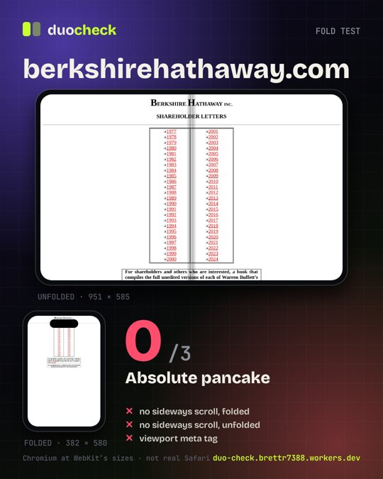

# Duo Check

**Does your site survive the fold?** Paste a URL. A real headless Chromium (Cloudflare Browser Rendering) opens it at the iPhone Duo's published WebKit sizes, folded and unfolded, then roasts it.

Live: https://duo-check.brettr7388.workers.dev



## What it does

| Pose | Viewport (CSS px) | DPR |
| --- | --- | --- |
| Folded | 382 x 580 | 3 |
| Unfolded, landscape | 951 x 585 | 3 |
| Unfolded, portrait | 669 x 867 | 3 |

Three checks, score out of 3:

1. No sideways scroll when folded.
2. No sideways scroll when unfolded (landscape).
3. The page has a `<meta name="viewport">` tag. Without it, Safari lays the page out at 980px and shrinks it.

The result page has a fold toggle with a CSS 3D hinge, a synthesized WebAudio hinge sound (plus a lo-fi loop, with a mute toggle) and a 1080x1350 canvas share card.

### Honest notes

- This is **Chromium at WebKit's published sizes, not real Safari on a Duo**. The UI says so. Safari-only layout quirks will not show up.
- The crease is cosmetic. The screenshot is one flat viewport, not split in two.
- Sideways scroll is measured as `scrollWidth` vs the pose width. Mobile emulation grows the layout viewport to the content width, so `innerWidth` is not used.
- A page with no viewport meta lays out at 980px and is flagged by both checks.

## Safety and limits

- **SSRF guard** (`src/ssrf.js`): only http/https, no credentials, default ports only, no private/loopback/link-local/CGNAT/metadata IPs (decimal, hex and IPv6-mapped forms included), no `.local`/`.internal`-style names. Hostnames are resolved over DNS-over-HTTPS and refused if they land in private space (fails closed). Every request the page makes in the browser, including redirects, goes through the same literal check.
- **Daily cap** (`DAILY_CAP`, default 25 fresh checks per UTC day). The Workers Free plan allows 10 Browser Rendering minutes/day, 3 concurrent browsers, and 1 new browser per 20 seconds, shared by every Worker on the account. One fresh check is about 6 browser seconds, so 25 fits with room to spare.
- **1 hour KV cache** per normalized URL. Repeat checks are free and do not count against the cap.
- **Per-IP rate limit**: one fresh check per IP per 20s. KV holds only a SHA-256 hash of the IP.
- A global launch gate keeps new browsers 21s apart, matching the free-plan limit.
- KV is eventually consistent and not atomic, so the cap is a friendly budget, not a hard lock.

## Run it

```sh
npm install
npm test                      # 22 unit tests: SSRF guard, cap, cache, scoring
node scripts/dev.mjs 8787     # serves public/ from disk, proxies /api to the live Worker (UPSTREAM env to change)
```

## Deploy

```sh
npx wrangler kv namespace create duo-check     # paste the id into wrangler.toml
npx wrangler deploy                            # needs `wrangler login` or CLOUDFLARE_API_TOKEN
```

No secrets live in this repo. Browser Rendering and KV are account bindings. `deploy/make-mcp-deploy.mjs` builds the same upload as a script for the Cloudflare MCP `execute` tool (`KV_ID=<id> node deploy/make-mcp-deploy.mjs out.js`).

## Layout

```
src/worker.js   routes, cap/cache/rate-limit flow
src/render.js   puppeteer: three poses, screenshots, overflow measurement
src/ssrf.js     URL guard      src/score.js   scoring + verdicts
src/cache.js    KV cache       src/limits.js  cap, IP gap, launch gate
public/         the whole UI (bundled into the Worker as text modules)
test/           node --test
```

Fonts: Bricolage Grotesque and JetBrains Mono (SIL OFL, licences in `public/fonts`). MIT licensed.
